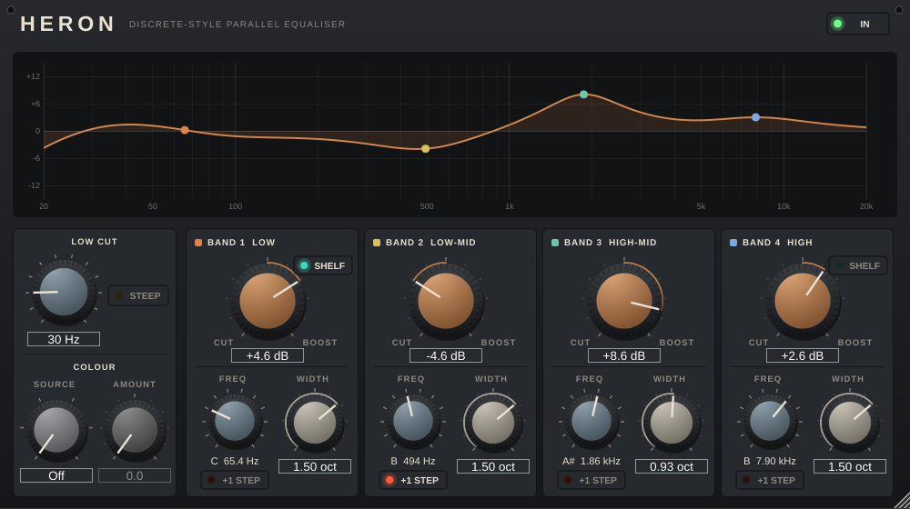

# Heron EQ

A four-band parallel equaliser plug-in (VST3 / AU / Standalone) inspired by the
behaviour of classic discrete Class-A program equalisers with musically stepped
frequencies. It is an independent design: it uses no code, artwork or trademarks
from any hardware manufacturer.



## Features

- **Four overlapping bands, 24 frequencies each.** Every band has 12 note-based
  positions, a major third apart, plus a **+1 STEP** switch that moves up one whole
  tone. That gives 96 frequencies in total, all on equal-tempered notes (A = 440 Hz):

  | Band | Range (+1 step off) | Range (+1 step on) |
  |------|---------------------|--------------------|
  | 1 Low      | C1 32.7 Hz – G#4 415 Hz   | D1 36.7 Hz – A#4 466 Hz |
  | 2 Low-mid  | C#3 139 Hz – A6 1.76 kHz  | D#3 156 Hz – B6 1.98 kHz |
  | 3 High-mid | A#4 466 Hz – F#8 5.92 kHz | C5 523 Hz – G#8 6.64 kHz |
  | 4 High     | G6 1.57 kHz – D#10 19.9 kHz | A6 1.76 kHz – F10 22.4 kHz* |

  *Above 20 kHz, but still valid because processing runs at 2× the sample rate.
- **Boost / cut ±12 dB** with a flat zone of ±0.3 dB at the centre, so a band is
  easy to set exactly flat.
- **Bandwidth from 0.2 to 4 octaves**, measured at full boost. At lower gain
  settings the curve gets wider, which is typical of this kind of circuit.
- **Shelving on bands 1 and 4.** In shelf mode the WIDTH knob sets how gentle the
  shelf is.
- **Low cut**: Out / 20–150 Hz, 12 dB/oct, or 24 dB/oct with **STEEP**.
- **Colour**: an additive 2nd/3rd-harmonic generator. It can apply to the full
  programme or to any single band. On a band it follows that band's boost or
  cut, so a **cut removes** harmonic content instead of adding it.
- 2× oversampling, a host bypass that crossfades with no click, and automation
  without zipper noise.
- Resizable vector UI with a live response curve.

## How the DSP works

All four band filters sit around one boost/cut amplifier, as in a parallel
hardware EQ, rather than in a series of biquads:

```
H(s) = (1 + Σ boost_k · F_k(s)) / (1 + Σ cut_k · F_k(s))
```

A boosting band feeds its filter forward. A cutting band sits in the feedback
path, and that delay-free loop is solved exactly every sample using TPT
state-variable filters. Boost and cut curves are therefore exact mirror images,
and overlapping bands interact the way they do on the hardware. Everything is in
`Source/HeronDSP.h`, which does not depend on JUCE.

## Building on macOS

Requirements: Xcode command-line tools and CMake 3.22 or newer
(`brew install cmake`). JUCE 8 is downloaded automatically.

```bash
cmake -S . -B build -DCMAKE_BUILD_TYPE=Release
```

```bash
cmake --build build --config Release --target HeronEQ_VST3 HeronEQ_AU -j8
```

This builds a universal binary (Apple Silicon and Intel). To install:

```bash
cp -R "build/HeronEQ_artefacts/Release/VST3/Heron EQ.vst3" ~/Library/Audio/Plug-Ins/VST3/
```

```bash
cp -R "build/HeronEQ_artefacts/Release/AU/Heron EQ.component" ~/Library/Audio/Plug-Ins/Components/
```

Or configure with `-DHERON_COPY_AFTER_BUILD=ON` to have the build copy them for you.

To open the project in Xcode instead, add `-G Xcode` to the configure command.

### Prebuilt binaries from GitHub Actions

Each push builds, tests and packages the macOS VST3 and AU. Download them from the
**HeronEQ-macOS** artefact on the Actions run. They are only ad-hoc signed, so remove
the quarantine flag after unzipping:

```bash
xattr -dr com.apple.quarantine ~/Library/Audio/Plug-Ins/VST3/"Heron EQ.vst3"
```

## Tests

```bash
cmake -S . -B build -DHERON_BUILD_HOST_TEST=ON
```

```bash
cmake --build build --target HeronDSPTests HeronHostTest HeronEQ_VST3
```

```bash
ctest --test-dir build --output-on-failure
```

```bash
build/HeronHostTest_artefacts/Release/HeronHostTest "build/HeronEQ_artefacts/Release/VST3/Heron EQ.vst3"
```

- `HeronDSPTests` checks the frequency tables, the dead zone, exact
  transparency when flat, ±12 dB at every band centre, boost/cut symmetry,
  bandwidth definition, the measured response against the on-screen curve,
  low-cut slopes, colour harmonics, and stability over 200 random settings.
- `HeronHostTest` loads the built VST3 as a host would. It checks latency,
  bypass, gain accuracy through the oversampler, a stress run with automation and
  odd block sizes, state save/restore, and that the editor opens.

## Ideas for later

- A "Mastering" mode: ±6 dB in 0.5 dB steps, and stepped bandwidth and colour.
- Dual-mono / mid-side operation with unlinked controls.
- Per-band insert sends (the hardware has them) via sidechain buses.
